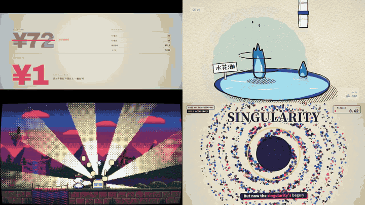
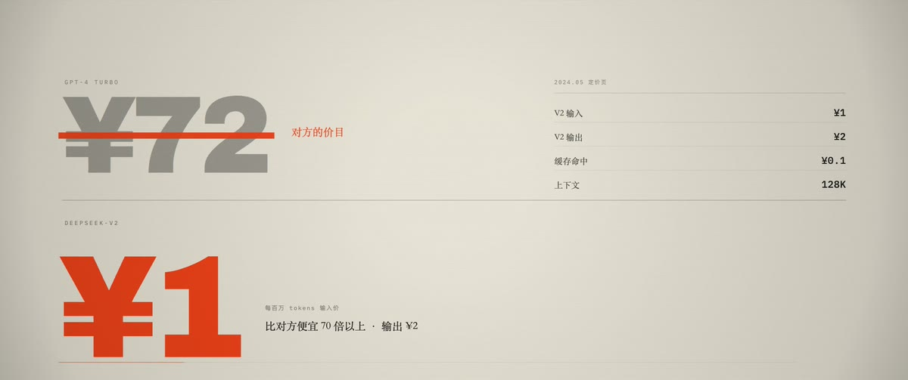
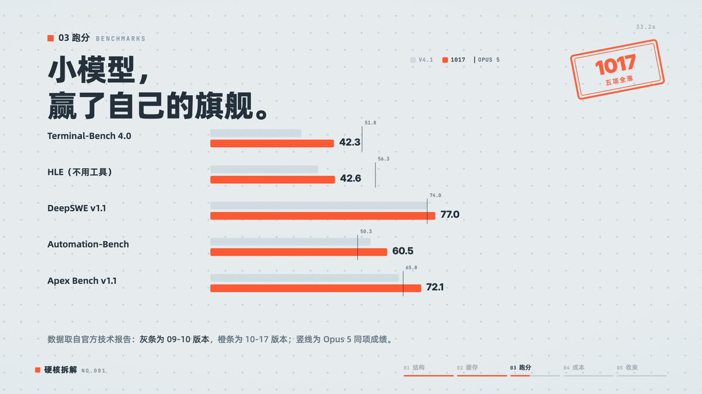
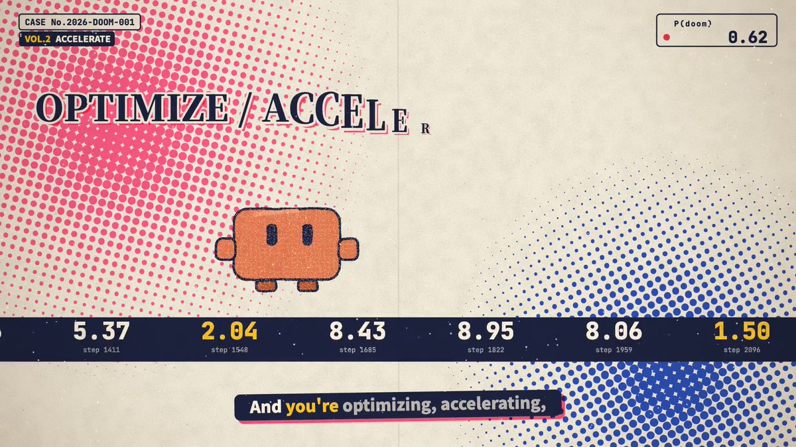
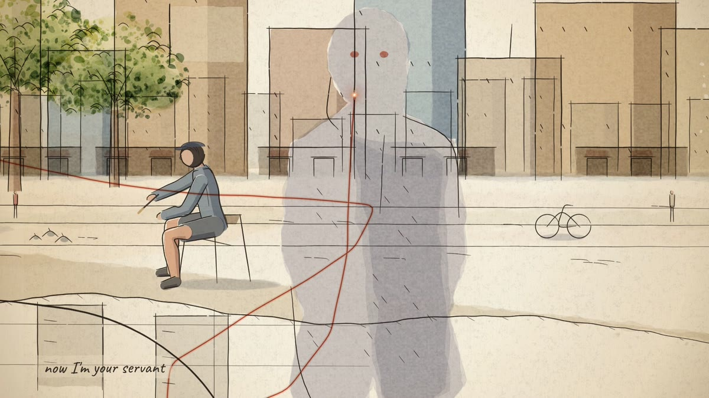

# opus-magic-video

**六支短片，全部由代码渲染出来。** 没有素材库、没有剪辑软件、没有时间轴拖拽——
每一帧都是 `renderAt(t)` 算出来的，配乐由 Python 按同一份事件表合成。

[English](README.md) | **简体中文** | [日本語](README.ja.md) | [Français](README.fr.md)



<sub>六支里取四支，各取 1.5 秒拼成 2×2。左上 `deepseek-one-line`、右上 `cel-boil-splash`、左下 `pixel-teyvat`、右下 `pdoom`。</sub>

---

## 成片

| 预览 | 片子 | 时长 | 风格 | 成片 |
|:---:|---|---:|---|---|
|  | [`deepseek-one-line/`](deepseek-one-line/) | 60s | **八章八材质**：制图纸 / 机房 / 收据 / 示波器 / 织物 / 机械 / 岩层 / 回到制图纸。28 个镜头讲完一条价格曲线 | [`out/video.mp4`](deepseek-one-line/out/video.mp4) · 2048×858 · 27 MB |
|  | [`deepseek-v41-flash/`](deepseek-v41-flash/) | 60s | **纸面 / 贴纸风 MG**，技术拆解：读得越多，每 token 反而越便宜 | 未渲染成片，[`out/stills/`](deepseek-v41-flash/out/stills/) 有静帧 |
|  | [`cel-boil-splash/`](cel-boil-splash/) | 10s | **逐帧手绘 / line boil**，水花精灵的崩解与重组 | [`out/video.mp4`](cel-boil-splash/out/video.mp4) · 1920×1080 · 36 MB |
|  | [`pixel-teyvat/`](pixel-teyvat/) | 10s | **320×180 像素冒险 + CRT**，开箱、昼夜交替 | [`out/video.mp4`](pixel-teyvat/out/video.mp4) · 1920×1080 · 13 MB |
|  | [`pdoom/`](pdoom/) | 156s | **复古半调案卷**，47 场景 / 46 句歌词，P(doom) 仪表四次上调 | [`pdoom-web.mp4`](pdoom/pdoom-web.mp4) · 1920×1080 · 79 MB |
|  | [`the-fuse/`](the-fuse/) | 30s | **街头速写 · 钢笔淡彩**：速写者把世界末日画进本子，一根橙色引线穿过八张跨页，每一笔都卡着歌 | [`the-fuse-30s.mp4`](the-fuse/the-fuse-30s.mp4) · 1920×1080 · 47 MB |

<sub>缩略图由 [`docs/make_preview.sh`](docs/make_preview.sh) 从成片抽帧生成，不是设计稿。</sub>

## 一帧画面 = 一个纯函数

前四支是**单文件时间轴 + `window.renderAt(t)` 可确定性寻帧**——画面、配乐、音效共用同一张
`cues.json`，改时间只改一处：

```
cues.json ──┬──> index.html   renderAt(t) ──> 逐帧截图 ──> ffmpeg ──> out/video.mp4
            └──> audio.py     synthesize() ──> out/audio.wav ──┘
```

因为画面完全由时间驱动，同一份代码在任何机器上逐帧一致：可以断点续渲、可以只渲一段验证构图、
也可以用静帧快速迭代而不用等整片。

`pdoom/` 是长片特例：156 秒、音乐已有独立声源，时间轴来自 `data/lyrics.json` 的词级时间戳，
因此走 `build.sh` 的分块渲染（拟音 → 渲染 → 混流 → 海报 → 字幕）。

`the-fuse/` 是另一种风格的长片特例：完整时间轴同样是 156.7 秒，仓库里放的是 30 秒展示版和完整源码。
它的钢笔淡彩引擎来自 [Lemo-Opuscar](https://github.com/lemomo-ai/lemo-opuscar)；剪辑、八张跨页与拟音是为本片新做的。

渲染器只有一个：起本地静态服务 → 等 `window.__ready` → 逐帧 `renderAt(t)` → 截图管道喂
ffmpeg（`tmix` 做运动模糊）→ H.264 + AAC。

## 目录

```
lib/audio/            mgaudio：合成引擎 + CC0 采样库（四支片子的 audio.py 共用）
requirements.txt      soundtrack 依赖（numpy/scipy/soundfile/numba/pedalboard…）
docs/preview/         README 缩略图与动图
docs/make_preview.sh  从成片重抽缩略图
<films>/              index.html · cues.json · audio.py · assets/ · out/
```

`out/stills/` 是逐时间点的校验静帧——不渲染整片也能看构图。
`deepseek-one-line/out/sheet.png` 是每 2 秒一格的总览图，判断整体节奏最快。

各片自有约定（细节看各片 `README.md`）：

- `deepseek-one-line/` — `index.html` 里是 `SHOTS` 28 镜头表 + `camAt()` 摄影机关键帧；
  `docs/TREATMENT.md` 是导演阐述（章节材质、镜头表、声音设计表）；`out/sheet/` 是逐秒缩略图（不入库）。
- `deepseek-v41-flash/`、`pixel-teyvat/`、`cel-boil-splash/` — `js/` 放场景模块，`assets/` 放字体与纹理。
- `pdoom/` — `film/` 是工程本体，`build.sh` 一键重建（拟音 → 渲染 → 混流 → 海报 → 字幕）。
- `the-fuse/` — `film.js` 是剪辑，`spreads.js` 是八张跨页，`cues.json` / `events.json` 是共用的时间源；
  `build.sh` 重建完整 156.7 秒成片（需要把 Lemo-Opuscar 放在 `$LIB`）。

## 跑起来

```bash
# 依赖
python3 -m venv .venv && .venv/bin/pip install -r requirements.txt
cd pixel-teyvat && npm install        # 每个 film 目录各自一次

# 预览（不落任何文件）
cd deepseek-one-line && node tools/serve.mjs     # → http://127.0.0.1:8777/index.html

# 静帧
node harness/render.mjs . --stills 0.5,5.6

# 配乐（锁 cues.json 的事件时刻）
.venv/bin/python audio.py                          # → out/audio.wav

# 成片
node harness/render.mjs . --out out/video.mp4 --audio out/audio.wav --workers 4

# 重抽 README 缩略图
./docs/make_preview.sh
```

需要本机装有 Google Chrome（渲染器用 `puppeteer-core` 驱动它，不下载 Chromium）和 `ffmpeg`。

`deepseek-one-line` 与 `deepseek-v41-flash` 的 `node_modules` 是本地软链（指向 `mg-styles-15/node_modules`），
克隆后需要自己 `npm i puppeteer-core`——`deepseek-one-line` 只用得上这一个，不需要 d3。

## 低成本复现 Opus 5.5 的质感

先说实话：**这些片子的质感不来自「模型更强」，来自三条工程约束。** 换一个愿意写代码的模型，
只要守住这三条，也能做出七成效果；反过来，用最好的模型但没有约束，只会得到一堆能播但不像作品的画面。

**① 确定性寻帧，而不是让动画自己跑。**
画面必须是 `renderAt(t)` 的纯函数——给同一个 `t`，永远画出同一帧。这样才有资格谈「修改」：
改一处，只需要重渲受影响的帧；不满意，可以只渲一段验证。CSS 动画自己跑、`requestAnimationFrame`
自己飘，就没法逐帧对齐，也没法重渲。

**② 单一时间源，画面和声音读同一张表。**
`cues.json` 里一个事件（`ev`）同时决定「第 12.4 秒这一帧砸下来」和「第 12.4 秒这一下音效」。
最贵的返工不是渲染，是音画不同步——把时间抽出来当数据，这个 bug 从结构上就不存在。

**③ 材质先定，再谈运镜。**
`deepseek-one-line` 的八章之所以站得住，是因为每章先定死一种物理材质（纸、收据、示波器、织物…），
再让同一条线去适应它。先想「这一段用什么材料做」，比先想「镜头怎么动」快得多，也不容易退化成
文字加淡入淡出。

成本上的实情：

| 项 | 成本 |
|---|---|
| 渲染算力 | **0**——本机 Chrome + ffmpeg，不用租 GPU |
| 60s 成片渲染 | 约 2 分钟 / 3 workers（`deepseek-one-line` 实测） |
| 10s 配乐合成 | 3–8 秒（`mgaudio`，纯 numpy 合成，无需采样库订阅） |
| 模型 token | **主要开销**。一支片的构思到交付是几十轮对话，省下的是算力，不是思考 |

所以「低成本」的准确含义是：**把成本从算力转移到约束设计上**。有参考库可抄时更省——挑一支已有风格，
改 `cues.json` 的时间和一个材质变量，就能在几分钟内看到自己的版本。这也是 `video_prototype/`
那批仓库最大的价值：它们不是让你从零发明，是让你从「已经能跑的东西」上改。

## 约束

- 时长/分辨率/fps 写在各片 `index.html` 的 `window.DEMO` 或 `cues.json` 里，渲染器读它。
- 画面必须完全由 `renderAt(t)` 驱动，不能用 CSS 动画自己跑——否则逐帧渲染会漂。
- 音频与画面共用 `cues.json` 的 `ev`，加一个视觉节拍就要同时在 `audio.py` 里补音效。
- 章内有硬切时，依赖绝对时间的动画要用章节时钟（`t - 章节起点`），不能用镜头内 `lt`，否则切点后整体错位。
- 暗场/细密纹理的片子（如 `deepseek-one-line`）渲染时加 `--mb 3 --shutter 0.5`，快推镜才不抖。

## 致谢

这套做法不是凭空发明的。下面这些上游仓库提供了骨架、样片和方法论，本项目在其上改写：

| 仓库 | 作者 | 在这里的角色 | 授权 |
|---|---|---|---|
| [mg-styles-15](https://github.com/Vincentwei1021/mg-styles-15) | Vincentwei1021 | **渲染器、`mgaudio` 合成引擎的来源**。`harness/render.mjs`、`lib/audio/` 直接取自这里；`cel-boil-splash` 改写自 `demos/05-cel-boil`，`pixel-teyvat` 改写自 `demos/20-pixel`，`deepseek-v41-flash` 的视觉语言参考 `demos/19-paperclip` | MIT |
| [video-shotcraft](https://github.com/Vincentwei1021/video-shotcraft) | Vincentwei1021 | **镜头词表**：124 张镜头配方卡 / 150 种动效。找「这一下该怎么拍」比发明更快 | Apache-2.0 |
| [lemo-opuscar](https://github.com/lemomo-ai/lemo-opuscar) | LemoLab | **59 种代码影片风格**。`pdoom` 的 `playwright-core` 依赖指向这里；数据叙事与 iso-infographic 方向有参考 | MIT |
| [huashu-motion](https://github.com/alchaincyf/huashu-motion) | Huashu | 产品发布片 skill 的完整工作流：写剧本、自己配乐、浏览器内改画面 | MIT |
| [pdoom-video](https://github.com/mexicat/pdoom-video) | Giacomo Magnanini | **生成式 MV 的范例**：歌词逐字同步 typography、确定性渲染。`pdoom/` 是它的本地改编版 | MIT |
| [openfilm/examples](https://github.com/openfilm/examples) | OpenFilm | 可打开、可改、可渲染的最小工程范例 | MIT |

另外：

- **字体**：LXGW Marker Gothic、Caveat、Long Cang、Fusion Pixel 12px、Press Start 2P，均为 SIL Open Font License 1.1；
  汉字笔顺数据来自 [hanzi-writer-data](https://github.com/skishore/makemeahanzi)（LGPL-3.0 / Arphic）。
- **采样**：`lib/audio/samples/` 为 CC0 VCSL 采样；其余音色由 numpy 程序合成，不含第三方素材。
- **`pixel-teyvat`**：派蒙精灵及提瓦特相关视觉设定版权归米哈游（miHoYo / HoYoverse），本项目为非商业粉丝向技术演示。

各片的具体出处见各自目录下的 `CREDITS.md`。参考库整体索引见 `video_prototype/README.md`。
